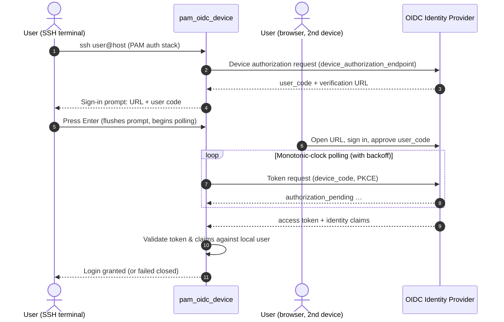

# PAM OAuth 2.0 Device Authorization Grant Module (`pam_oidc_device`)

[](https://github.com/ncsa/pam_oidc_device/actions/workflows/build.yml)
[](https://github.com/ncsa/pam_oidc_device/actions/workflows/lint.yml)
[](LICENSE)

> [!WARNING]
> **Pre-Release Notice**:
> This module is in active pre-release. It has passed initial functional testing and automated test suites, but awaits formal security review (see the [Developer Review Guide](docs/developer/review.md)). We encourage community testing and feedback, but advise against deploying to live production systems without prior internal audit.

`pam_oidc_device` is a Linux PAM module — a small program that plugs into the
PAM authentication stack of services such as OpenSSH — that enables
OpenID Connect sign-in via the **OAuth 2.0 Device Authorization Grant**
([RFC 8628](https://www.rfc-editor.org/rfc/rfc8628)). Users approve logins in a
browser on a second device instead of entering passwords directly into SSH;
once the provider approves the code, the module validates the provider's
identity claims and completes the login sequence. It works with any
[OIDC](https://openid.net/) identity provider (e.g., Microsoft Entra ID,
Okta, Keycloak, Auth0) and — because it is a standard PAM module — extends
beyond SSH to any PAM-managed service that gives the user a terminal.

Designed for Linux servers, HPC systems, bastion hosts, research computing
environments, and other systems that need browser-based authentication without
running a local web login flow.

## The Device Authorization Grant (RFC 8628)

The **OAuth 2.0 Device Authorization Grant** ([RFC 8628](https://www.rfc-editor.org/rfc/rfc8628)) is the standard authorization flow for **limited-input clients** — systems with no comfortable place to type a username and password. It splits sign-in across two devices: the limited-input client requests a short, single-use **user code** and a **verification URL**, displays both, and then polls the identity provider; on *any other* device, the user opens the URL, signs in, and approves the code. No password ever travels through the limited-input client — the only secret it handles is the short, expiring user code. The same pattern powers smart-TV and streaming apps, game consoles, and headless devices.

The full background, and how it maps onto a Linux PAM module, is in the [device-flow guide](docs/device-flow.md).

---

## Use Cases

`pam_oidc_device` is useful when:

* SSH passwords should never be typed into shared systems.
* Local accounts need to be tied to Entra ID identities.
* Password authentication has been disabled.
* MFA enforcement should occur at the identity provider.
* HPC, research, or bastion hosts need centralized identity management.

---

## How It Works

The device flow delivers out-of-band sign-in without any client-side software on the login host.

**Figure 1 — Device-flow authentication sequence.** The SSH terminal (limited-input client) and
the browser on a second device are both operated by the user; the PAM module talks only to the
identity provider:



What the SSH session looks like (built-in default prompt; the optional QR code is omitted here):

```text
Sign in via browser:
  https://auth.example.com/oauth2/device/code?user_code=ABCD-EFGH

Manual entry: https://auth.example.com/oauth2/device/code  |  Code: ABCD-EFGH
Waiting for approval (expires in 2m).
Press [Enter] to begin...
```

Details the diagram does not show:

* **Enter flushes the prompt.** After the sign-in prompt is shown, the module
  waits for you to press **Enter** before polling begins. The keystroke
  reliably flushes the prompt to OpenSSH keyboard-interactive clients, which
  otherwise buffer informational text until a prompt triggers a round-trip.
* **Monotonic-clock polling.** The module polls the token endpoint on a
  monotonic clock — a stopwatch that only ever counts forward — so its timing
  stays accurate even if the system's wall-clock time is adjusted (e.g., via
  NTP or a manual time change).
* **Fail-closed validation.** Once the provider approves the code, the module
  validates the returned token and identity claims against the local system
  user (plus any configured group/role and JWT claim checks) before completing
  the login — or fails closed, blocking it.

No passwords cross the wire in this flow, and no provider credentials live on the host beyond the `client_id`/`client_secret` in the root-only config file.

---

## Device Flow Is Not MFA By Itself

This module enforces one thing: that the login was approved **out-of-band** by your identity
provider through the device flow, plus any claim, group, and role policies you configure. By
itself it does not require a second factor — a user whose provider sign-in is just a password has
completed exactly one factor through this module.

That is why this module is normally deployed *as one layer of a larger control*. When your PAM
stack combines the device-flow sign-in with other PAM modules, or when your identity provider
enforces a second step (e.g., a phishing-resistant MFA challenge) during the browser sign-in, the
resulting login *is* multi-factor; the module is the out-of-band step in that combination, not an
MFA guarantee on its own. See [Use Cases](#use-cases) and the
[Threat Model](docs/threat-model.md) for the deployment guidance.

---

## Key Features

* **Standard RFC 8628 Flow:** Monotonic-clock (`CLOCK_MONOTONIC`) polling immune to wall-clock time adjustments, resilient backoff for transient network errors, and real-time prompt streaming over SSH `keyboard-interactive` sessions. The first token poll fires immediately once you press Enter, so approval on the second device is detected the moment polling begins — even if it happened while the confirmation prompt was still waiting.
* **PKCE (RFC 7636):** Optional S256 code-verifier/code-challenge pairs bind the token exchange to the originating device-flow attempt; enabled via `use_pkce = true|false|auto` (`auto` probes the provider's discovery document once and fails safe to off).
* **Flexible Claim Mapping:** Extract local system usernames from OIDC UserInfo claims (`sub`, `preferred_username`, etc.) using POSIX Extended Regular Expressions.
* **Pre-Flight Access Controls:** Reject unauthorized local accounts *before* contacting the identity provider, limiting identity mapping risks.
* **Group & Role Authorization:** Restrict access to users belonging to specific provider groups or roles.
* **Sign-In Confirmation:** The module shows the sign-in URL and code, then waits for a single Enter before polling the token endpoint begins — giving you time to note the URL and code on a secondary device.
* **Security & Memory Hardening:** Zeroes sensitive memory buffers in process RAM (`secure_memzero`), enforces strict root ownership (`0600`/`0640` permissions), and sanitizes terminal output against ANSI escape sequence injection.
* **Convenience: Terminal QR Sign-In:** As a usability enhancement, the opt-in `[qr]` section renders the device-flow sign-in URL as a scannable QR code on TTY logins so users can open it with a phone camera. The QR code plays no role in the authentication architecture: it is off by default, authentication never depends on it, and when it is disabled or rendering fails, the plain text prompt is still shown.

---

## Quickstart

Deploy `pam_oidc_device` in 4 steps. The complete walkthrough — prerequisites, provider configuration values, `authselect` on Enterprise Linux, and logging — lives in the [Getting Started guide](docs/getting-started.md); to install a prebuilt RPM/DEB instead of compiling, see the [RPM/DEB packaging guide](docs/packaging.md).

### Step 1: Install the Module

```bash
git clone https://github.com/ncsa/pam_oidc_device.git
cd pam_oidc_device
# install your distro's build dependencies first —
# see the per-distro lists in Getting Started §2
make
sudo make install
```

---

### Step 2: Configure `/etc/pam_oidc_device.conf`

Create or edit `/etc/pam_oidc_device.conf` (owned by `root:root`, permissions `0600`) with the four
required provider endpoints and your claim mapping:

```ini
[oauth]
client_id = your-oauth-client-id
device_authorization_endpoint = https://auth.example.com/oauth2/v2.0/devicecode
token_endpoint = https://auth.example.com/oauth2/v2.0/token
userinfo_endpoint = https://auth.example.com/oauth2/v2.0/userinfo
scopes = openid profile email

[claim]
# claim_regex is REQUIRED (there is no default)
claim_field = preferred_username
claim_regex = ^jdoe$
```

The full annotated template — every option including `use_pkce`, access controls, prompt
customization, and the opt-in `[qr]` section — is in
[Getting Started §3](docs/getting-started.md).

---

### Step 3: Enable OpenSSH Keyboard-Interactive Mode

Ensure `/etc/ssh/sshd_config` permits interactive PAM prompting:

```sshd_config
UsePAM yes
KbdInteractiveAuthentication yes
AuthenticationMethods keyboard-interactive
```

Reload SSH configuration:

```bash
sudo systemctl reload sshd
```

(Extended hardening — connection-burst throttling, rate-limiting, and idle pre-auth timeouts — is in [Getting Started §4](docs/getting-started.md).)

---

### Step 4: Add Module to PAM (`/etc/pam.d/sshd`)

Append `pam_oidc_device.so` into your PAM SSH authentication stack (`/etc/pam.d/sshd`):

```pam
# /etc/pam.d/sshd
auth        required      pam_sepermit.so
auth        substack      password-auth
# Guard non-system accounts (UID >= 1000)
auth        required      pam_succeed_if.so uid >= 1000 quiet
auth        required      pam_oidc_device.so
auth        include       postlogin
```

> [!WARNING]
> **Use `required` (or `requisite`), not `sufficient`.** If `pam_oidc_device.so` fails for any reason — a rejected user code, a claim/identity mismatch, a network/IdP error, or an invalid `/etc/pam_oidc_device.conf` — a device-flow login can't complete, and with `sufficient` that failure does **not** block login: PAM moves on to the next module and can authenticate the user through your fallback method **without ever completing the OIDC flow**. `required` / `requisite` keeps the module fail-closed so a misconfiguration can't silently downgrade authentication. See [Getting Started §5](docs/getting-started.md) for the full discussion, and §6 for keeping the integration across `authselect` profile re-applications on Enterprise Linux.

---

## Beyond SSH: Other PAM Services

OpenSSH is the primary, best-documented use case for this module, but `pam_oidc_device` is a standard PAM module: the same device-flow sign-in works with **any Linux service that authenticates through PAM** and gives the user a terminal to read the verification prompt:

* **`sudo` and `su`** — device-flow step-up before privilege escalation (`/etc/pam.d/sudo`, `/etc/pam.d/su`);
* **Local console and display-manager logins** (`login`/`getty`, GDM, SDDM) — where the optional terminal QR code makes approval especially quick, since a phone is usually right there;
* **PAM-aware daemons and stacks** (LXD, Proxmox VE, and similar services that gate their operations through PAM).

Two rules apply outside SSH:

1. **The user needs an interactive terminal.** The flow requires reading the URL/code and pressing Enter, so services without an interactive user — cron jobs, `sudo -n`, non-interactive PAM policy checks — cannot complete it.
2. **The fail-closed rule applies everywhere.** Use `required` or `requisite`, never `sufficient`, in every PAM stack you add the module to (the Step 4 warning above).

For service-specific stack placement and the `authselect` interaction, see [Getting Started §5–§6](docs/getting-started.md).

---

## Documentation

Pick the guide that matches what you are about to do:

| I want to… | Read |
| --- | --- |
| **Deploy it from scratch** (install, config, OpenSSH, PAM stack, `authselect`, logging) | [Getting Started](docs/getting-started.md) |
| **Understand the device flow protocol** (RFC 8628 background, where you've seen it before, how it maps to PAM) | [Device-Flow Guide](docs/device-flow.md) |
| **Protect something other than SSH** (`sudo`, `su`, console logins, PAM-aware daemons) | [Beyond SSH: Other PAM Services](#beyond-ssh-other-pam-services) |
| **Connect my identity provider** (discover endpoints, PKCE support, complete config templates) | [Provider Examples & Discovery](examples/README.md) |
| **Test it before relying on it** (one-command e2e sandbox, `pamtester`, trial IdP, pre-production audit) | [Testing & Pre-Production Audit Guide](docs/testing.md) |
| **Restrict who can log in** (local users, provider groups/roles) | [Account & Group Access Control](docs/access-control.md) |
| **Harden token acceptance** (issuer pinning, audience, `exp`/`nbf`) | [Local JWT Claim Inspection](docs/jwt-validation.md) |
| **Understand the security model** (threat matrix, injection defense, memory scrubbing, credential handling) | [Security Policy](SECURITY.md), [Threat Model](docs/threat-model.md), [Security & Credential Handling](docs/security.md) |
| **Review accessibility & compliance posture** (WCAG 2.1 AA, terminal UX) | [Accessibility](docs/accessibility.md) |
| **Build RPM/DEB packages** | [Building RPM & DEB Packages](docs/packaging.md) |
| **Contribute** (build/test gates, developing on non-Linux hosts) | [Contributing Guide](CONTRIBUTING.md) |

---

## Security & Credential Handling

The module keeps provider secret materials in volatile memory only: device codes, tokens, and
response bodies are never written to disk or swap, and module-owned secrets (client secret,
access/refresh tokens, decoded JSON fields) are scrubbed with `secure_memzero` before release.
Every terminal-facing value (URLs, user codes, rendered prompts) is validated against ANSI and
control-character injection before display.

The full treatment — threat matrix, attack-vector breakdown, trust boundaries, user-code format
policy, and the client-authentication method (`client_secret_post`) — is in the
[Security & Credential Handling guide](docs/security.md) and the
[Threat Model & Security Architecture](docs/threat-model.md).

---

## Logging & Auditing

All module authentication events write to `syslog` under facility `LOG_AUTHPRIV` (typically `/var/log/secure` or systemd journal).

To trace live logins and troubleshoot issues:

```bash
sudo journalctl -f -u sshd | grep pam_oidc_device
```

To enable detailed tracing temporarily, set `loglevel = debug` or `loglevel = verbose` in the `[runtime]` section of `/etc/pam_oidc_device.conf`.

---

## Third-Party Components & Licenses

The module's own code is MIT-licensed. It vendors exactly one third-party component —
**Project Nayuki's QR Code generator (C edition, MIT)** — and otherwise links against
standard system libraries that ship as distribution packages (Linux-PAM, cURL, json-c,
OpenSSL; CMocka is build/test-only and never shipped).

Full licensing, provenance pins, local-deviation records, and the license-audit procedure
are maintained in [THIRD_PARTY_NOTICES.md](THIRD_PARTY_NOTICES.md) and checked
automatically in CI (the [license audit workflow](.github/workflows/license-audit.yml)
plus the [vendor drift audit](.github/workflows/vendor-audit.yml)).

---

## Accessibility

This project's documentation and terminal user experience are built to
[WCAG 2.1 Level AA](https://www.w3.org/TR/WCAG21/) — the shared technical
baseline of the accessibility mandates governing NCSA / University of
Illinois public-facing content (IITAA 2.1, ADA Title II, and Section 508).

In short: the guides under `docs/` use semantic headings, tables with header
rows, and text alternatives for every image; the terminal sign-in experience
is text-first and screen-reader friendly — the sign-in URL and user code are
always presented as plain, selectable terminal text, and failed attempts
deliver a plain-text, actionable explanation rather than a bare
"permission denied." The optional `[qr]` code is strictly supplemental:
authentication never depends on it, and `style = ascii` renders it for
minimal fonts.

The full details — each mandate, the concrete WCAG criteria in play, and
how to report an accessibility barrier — are in the
[Accessibility guide](docs/accessibility.md).

---

## License & Community

* **License:** This project is licensed under the [MIT License](LICENSE).
* **Release History:** See [CHANGELOG.md](CHANGELOG.md).
* **Security Disclosures:** See [SECURITY.md](SECURITY.md).
* **Contributing:** See [CONTRIBUTING.md](CONTRIBUTING.md).

Developed and maintained by **NCSA CyberInfrastructure** ([NCSA website](https://www.ncsa.illinois.edu/)).
