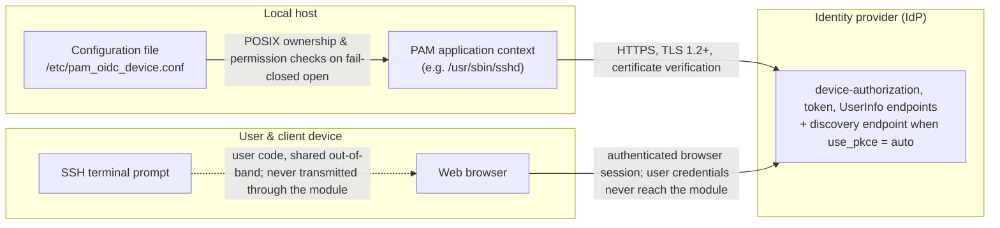
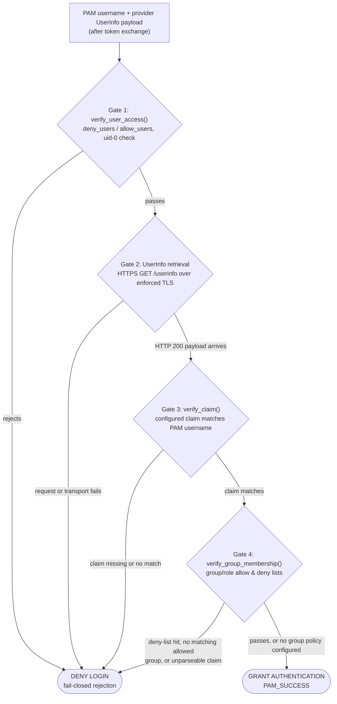

# Threat Model & Security Architecture

`pam_oidc_device` is a Linux Pluggable Authentication Module (PAM) executing inside privileged process spaces (such as OpenSSH `sshd`) to authenticate system users via the [OAuth 2.0 Device Authorization Grant](https://oauth.net/2/device-flow/) ([RFC 8628](https://www.rfc-editor.org/rfc/rfc8628)). Because authentication modules operate at the primary security boundary of the operating system, this document details the system trust boundaries, threat matrix, defense mechanisms, and implementation specifics. OpenSSH is the concrete deployment used throughout; the trust boundaries and controls hold for any PAM-managed service that hosts the module (see [Beyond SSH: Other PAM Services](../README.md#beyond-ssh-other-pam-services)).

> **Security disclosures.** To report a vulnerability in `pam_oidc_device`, follow the [security disclosure procedure](../SECURITY.md).

> [!NOTE]
> **Key finding — the module's top residual risk.** Device-code phishing (§8) cannot
> be closed in-module: in that attack the sign-in prompt reaches the *attacker*, not
> the approving user, so no in-prompt control can stop it. It is mitigated only by
> operator controls — one descriptive OAuth client per host, source-network limits,
> and user vigilance. All other threats below have in-module or in-stack technical
> mitigations.

## Table of Contents

* [Trust Boundaries](#trust-boundaries)
* [Threat Matrix](#threat-matrix)
* [Security Controls & Mitigation Deep Dives](#security-controls--mitigation-deep-dives)
  * [1. Terminal Escape Sequence & Injection Defense](#1-terminal-escape-sequence--injection-defense)
  * [2. Process Memory Hardening & Secret Disposal](#2-process-memory-hardening--secret-disposal)
  * [3. File System & Configuration Permissions Hardening](#3-file-system--configuration-permissions-hardening)
  * [4. Identity Mapping & Pre-Flight Access Control](#4-identity-mapping--pre-flight-access-control)
  * [5. Local JWT Claims Inspection vs. Downstream Signature Enforcement](#5-local-jwt-claims-inspection-vs-downstream-signature-enforcement)
  * [6. HTTP Transport Security & Network Resilience](#6-http-transport-security--network-resilience)
  * [7. PKCE Device-Flow Binding (RFC 7636)](#7-pkce-device-flow-binding-rfc-7636)
  * [8. Device-Code Phishing — Residual Risk & Hardening](#8-device-code-phishing--residual-risk--hardening)
  * [9. Provider Rate-Limit Exhaustion — Operational Hardening](#9-provider-rate-limit-exhaustion--operational-hardening)
* [Out-of-Scope Security Assumptions](#out-of-scope-security-assumptions)
* [Related Documents](#related-documents)

---

## Trust Boundaries

The module operates across three distinct operational boundaries:

**Figure 1 — Trust boundary overview.** The three trust zones, and the
trust relationships that run within and between them:



*Zones:*

| Zone | Contents |
| --- | --- |
| **Local host** | A PAM application context (e.g., `/usr/sbin/sshd`) and the configuration file `/etc/pam_oidc_device.conf`. |
| **Identity provider (IdP)** | The device-authorization, token, and UserInfo endpoints — plus the OIDC discovery endpoint when `use_pkce = auto`. |
| **User & client device** | The SSH terminal prompt and an external web browser. |

*Trust relationships:* each arrow in the figure labels the protection on that
relationship (fail-closed config-file checks; enforced TLS 1.2+ with certificate
verification; a browser session that never exposes user credentials to the
module; and a user code shared out-of-band, never transmitted through the
module).

### 1. Local Host Integrity (Privileged Kernel & Process Boundary)

* **Assumptions**: The host kernel, file system, `sshd` process space, root account, and system PAM architecture are untampered with and secure.
* **Scope**: Module binary execution, local configuration parsing, process RAM management, and system log emissions (`syslog`).

### 2. Network Transport Boundary (Host-to-IdP)

* **Assumptions**: Identity Provider endpoints (`device_authorization_endpoint`, `token_endpoint`, `userinfo_endpoint`) may exist over untrusted public networks.
* **Scope**: Enforced TLS/HTTPS protocol encryption, TLS host and certificate verification, and payload size restriction.

### 3. Out-of-Band User Authentication Boundary

* **Assumptions**: The user terminal running the SSH session is physically or logically separated from the web browser used to complete OAuth authentication.
* **Scope**: Formatting user prompts, sanitizing user verification codes, display safe output streaming, and polling interval timing.

---

## Threat Matrix

| Risk | Threat Vector | Description | Primary Mitigation | Code Implementation |
| --- | --- | --- | --- | --- |
| **High** | Terminal Injection | Malicious IdP payload or customized prompt template injects ANSI escape sequences into terminal. | Strict printable ASCII character checks and line-by-line validation of rendered user prompt templates. | `is_safe_terminal_string()`, `is_safe_user_code()`, `is_valid_https_url()`, `render_prompt_message()` |
| **High** | Process Memory Leak | Access tokens, client secrets, or sensitive identity claims persist in heap memory after authentication. | Volatile memory zeroing of buffers and deep recursive scrubbing of JSON object trees before deallocation. | `secure_memzero()`, `secure_zero_json_tree()`, `free_http_response()` |
| **High** | Policy Bypass via Local Mapping | Authenticated IdP identity maps to an unauthorized local system account name. | POSIX extended regex claim matching with strict capture groups, case sensitivity controls, and local allow/deny list checks. | `verify_claim()`, `verify_user_access()` |
| **Medium** | Privilege Escalation via Group Claims | IdP user lacking required operational roles gains host machine access. | Evaluation of UserInfo group/role claims against strict allow and deny group lists (deny list takes precedence). | `verify_group_membership()` |
| **Medium** | Config File Manipulation | Low-privileged local user tampers with `/etc/pam_oidc_device.conf` or uses symlink traversal to alter auth logic. | Secure file descriptor opening (`O_NOFOLLOW`, `O_CLOEXEC`), strict file ownership checks (`uid 0`, `gid 0`), and permission validation (`0600`/`0640`). | `load_config()` |
| **Medium** | Token Replay / Token Spoofing | Stale, expired, or wrong-audience access tokens are accepted by the PAM module. | Authoritative IdP enforcement when the token is presented to the `userinfo_endpoint`, complemented by a fail-closed `token_type = Bearer` check, opt-in local claims inspection (`exp`, `nbf`, `iss`, `aud`), and a JWT-sub ↔ UserInfo-sub consistency check. | `verify_token_metadata()`, `jwt_extract_claim_string()` |
| **High** | Device-Code Phishing (Social Engineering) | An attacker who already has a terminal session on the host initiates the device flow *themselves* and persuades a victim to approve it; the identity check passes because the identity really is the victim's, and PKCE offers no protection because the attacker holds the flow's `code_verifier`. | **Residual risk — cannot be closed in-module** (the sign-in prompt reaches the attacker, not the approver). Mitigated only by operator controls: one descriptive OAuth client per host, source-network limits, second factor on the approval session, user vigilance. See §8. | operator policy; full analysis in §8 |
| **Medium** | Device Code Interception / Replay | An attacker who *intercepts or recovers* a live `device_code` (log leakage, network compromise, shoulder-surfing) attempts to complete the token exchange instead of the legitimate flow. | Optional PKCE (RFC 7636) S256 binding: a fresh per-attempt CSPRNG `code_verifier` ties the token exchange to the flow's *initiator*, so a stolen `device_code` alone cannot obtain tokens when enabled. **Scope boundary:** this does not stop device-code phishing, where the attacker *is* the initiator (§8). | `pkce_generate_code_verifier()`, `pkce_compute_s256_challenge()`, `use_pkce`; see §7 |
| **Low** | Denial of Service (DoS) via HTTP Buffers | Rogue server sends unbounded HTTP response payloads or redirection loops to exhaust host resources. | Strict HTTPS protocol enforcement, redirection disabling, request timeouts, and fixed response size limits (256 KiB). | `http_request()`, `write_callback()` |
| **Medium** | Provider Rate-Limit Exhaustion (Self-DoS) | A pre-auth source that loops SSH connections against usernames passing the local pre-flight check issues one device-authorization request per connection and can exhaust the OAuth client's provider-side rate limit, locking out legitimate sign-ins (HTTP 429 / `slow_down`). | Per-source pre-auth throttling at the SSH layer plus narrow local allow-lists (rejection happens before any provider contact); in-module limiting is out of PAM scope. See §9. | sshd configuration; `verify_user_access()` pre-flight; see §9 |

---

## Security Controls & Mitigation Deep Dives

### 1. Terminal Escape Sequence & Injection Defense

Terminal escape sequences (e.g., ANSI control codes) sent to an SSH terminal can manipulate terminal settings, obscure prompt text, or execute unauthorized commands in vulnerable terminal emulators.

* **URL Validation**: Verification URIs returned by the identity provider — and, at load time, every operator-configured endpoint — are validated by `is_valid_https_url()`, which requires the `https://` scheme, printable ASCII only (no control bytes), no fragment (`#`), and rejects authority userinfo (`user:pass@host`). Malformed or non-HTTPS URIs are refused before they can reach the terminal.
* **User Code Filtering**: User codes are sanitized by `is_safe_user_code()`, which limits length to 64 bytes and restricts characters exclusively to alphanumeric characters, spaces, hyphens, and underscores.
  * The sanitizer enforces terminal safety only — not code *format*: RFC 8628 §3.1's character-set recommendations (e.g., a consonant-only base-20 set, or omission of visually ambiguous characters such as `0`/`O` and `1`/`l`/`I`) and display chunking (e.g., `WDJB-MJHT`) are server-side choices made by the identity provider when it issues the code.
  * The module therefore deliberately neither rejects nor reformats codes containing vowels, ambiguous glyphs, or un-chunked sequences — rejecting them would break compatibility with providers that do not follow those recommendations.
* **Line-by-Line Prompt Rendering**: Terminal prompts rendered via `render_prompt_message()` replace `{url}`, `{url_complete}`, `{code}`, `{expiry}`, and newline (`\\n`) placeholders. The final rendered prompt is verified by `is_safe_rendered_prompt()`, which splits output on newlines and ensures every line contains strictly printable ASCII characters (range 32–126) via `is_safe_terminal_string()`; unsafe template/URL/code content therefore fails authentication fail-closed. The prompt deliberately carries no host identification: in a device-code phishing attack it reaches the ssh initiator (the attacker), not the approving user — machine context belongs on the IdP's approval page (§8).

### 2. Process Memory Hardening & Secret Disposal

PAM modules run within the address space of privileged host daemons. Sensitive strings left in heap memory can be exposed through core dumps, memory inspection, or uninitialized buffer reallocations.

* **Volatile Memory Scrubbing**: The module uses `secure_memzero()`, which accesses memory through a `volatile unsigned char *` pointer to prevent optimizing compilers from removing zero-fill operations (Dead Code Elimination).
* **Recursive JSON Tree Scrubbing**: `secure_zero_json_tree()` recursively traverses parsed `json-c` object structures (strings, arrays, and sub-objects) and overwrites internal string bytes with zeroes before calling `json_object_put()`.
* **Lifecycle Cleanup**: Client secrets, OAuth device codes, access tokens, form POST fields, HTTP response buffers, and template buffers are scrubbed immediately after use during module teardown.

### 3. File System & Configuration Permissions Hardening

Configuration files stored at `/etc/pam_oidc_device.conf` contain identity provider settings and security policies.

* **Descriptor-Based Security**: `load_config()` opens configuration files using `open()` with flags `O_RDONLY | O_NOFOLLOW | O_CLOEXEC` to prevent symlink traversal attacks and descriptor leaks to child processes.
* **Regular File & Owner Checks**: `fstat()` verifies the descriptor refers to a regular file (`S_ISREG`) and enforces root owner validation (`st_uid == 0`).
* **Mode Enforcement**: Access modes must strictly be `0600` (read/write by root only) or `0640` (read/write by root, read by group root where `st_gid == 0`). Files with permissive permissions are rejected.

### 4. Identity Mapping & Pre-Flight Access Control

Mapping identity claims from an [OpenID Connect Core 1.0](https://openid.net/specs/openid-connect-core-1_0.html) provider to a local system account requires strict policy verification to prevent unauthorized account access. For configuration options, see the [account and group access control guide](access-control.md).

**Figure 2 — Access-control decision flow.** After the device-authorization
token exchange completes, a linear sequence of gates is evaluated using the PAM
username and the provider's UserInfo payload: any failed gate fails closed and
rejects the login, and only a fully passing path reaches
**GRANT AUTHENTICATION** (`PAM_SUCCESS`):



| # | Gate | What is evaluated | Rejects when | Continues when |
| --- | --- | --- | --- | --- |
| 1 | `verify_user_access()` | `deny_users` / `allow_users` on the PAM username; the deny list always takes precedence; any uid-0 account (`root` and alternative uid-0 names) is denied unless `allow_root = true` is set explicitly; when `deny_system_uids = true` (default) any local account whose numeric UID falls in `[system_uid_min, system_uid_max]` (default 0-999) is denied regardless of the lists — a uid-0 account already exempted via `allow_root` is not re-denied by this range gate | The user is listed in `deny_users`; the user is a uid-0 account without an explicit `allow_root = true` opt-in; the user's numeric UID falls within the denied system-UID range; or the user is absent from a configured `allow_users` list | The user passes local account filtering |
| 2 | Provider UserInfo retrieval | `HTTPS GET /userinfo` over the enforced TLS 1.2+ transport | The transport or HTTP request fails — the gate is fail-closed | The claim payload arrives (HTTP 200) |
| 3 | `verify_claim()` | The configured identity claim, extracted from the payload by regex, compared against the PAM username | No configured claim is present, or the extracted value does not match the PAM username | The claim matches the PAM username |
| 4 | `verify_group_membership()` | The group/role values of the configured UserInfo claim (`group_claim_field`, default `groups`) compared against `allow_groups` / `deny_groups`; deny values take precedence | The user holds a group/role listed in `deny_groups`, or holds none that satisfy a configured `allow_groups` list; the gate also rejects when group enforcement is enabled but no list is configured, and — with any group policy active — when the claim is missing, JSON null, of an unrecognized type, or not fully parseable (fail-closed) | Group policy passes, or no group policy is configured (gate bypassed) |
| 5 | — | — | — | **GRANT AUTHENTICATION** — `PAM_SUCCESS` is returned to the PAM stack |

* **Local pre-flight filtering**: `verify_user_access()` (gate 1) runs *before* any provider contact, so a locally-denied account never triggers a device-flow. Deny lists take precedence; uid-0 accounts (`root` and any alternative uid-0 name) are refused unless `allow_root = true`; and, by default (`deny_system_uids = true`), every local account whose numeric UID falls in the configurable system range `[system_uid_min, system_uid_max]` (0-999) is refused — the guard targets the UID, not the name, so service accounts holding in-range UIDs are denied even when listed in `allow_users` (a `pam_succeed_if uid >= 1000` pre-gate in the PAM stack is the complementary control).
* **Regex claim extraction**: `verify_claim()` compiles `claim_regex` with [POSIX extended regular expressions](https://pubs.opengroup.org/onlinepubs/9699919799/basedefs/V1_chap09.html) (`REG_EXTENDED`), extracts capture group `claim_capture_group`, and compares it to the PAM user. Matching honors `case_sensitive`; the case-insensitive path uses a byte-wise `ascii_strcasecmp()` so results never vary with the ambient locale.
* **Group authorization**: `verify_group_membership()` (gate 4) compares the `group_claim_field` value (default `groups`) — a JSON array, a single string, or a comma-separated string — against `allow_groups` / `deny_groups`; deny values take precedence.
* **PII-safe audit logging**: The raw UserInfo payload (which holds personal data) is never written to the system log at the routine levels. At `DEBUG` the module records only the payload size and configured claim field; at `VERBOSE` — the operator's maximum troubleshooting level, off by default — it additionally dumps every claim returned by the provider (name + compact JSON value, claim values C-escaped), and a claim name containing non-printable bytes is withheld from the log.

### 5. Local JWT Claims Inspection vs. Downstream Signature Enforcement

When local JWT verification is enabled (`verify_jwt_claims = true`), `verify_token_metadata()` performs pre-flight claim inspection per [RFC 7519](https://www.rfc-editor.org/rfc/rfc7519). For details on configuring issuer and audience checks, see the [local JWT claim inspection guide](jwt-validation.md).

* **Structural Integrity**: Confirms standard 3-part Base64URL JWT structure (`header.payload.signature`).
* **Temporal Validation**: Validates `exp` (Expiration Time) and `nbf` (Not Before) numeric claims against host time (`time(NULL)`), allowing for configurable clock skew (`clock_skew_leeway`).
* **Issuer & Audience Pinning**: Verifies that `iss` matches the configured `issuer` and `aud` matches one or more allowed `audience` entries.
* **Subject Consistency (token-substitution defense)**: The access token's `sub` claim is cross-checked against the `sub` returned by the UserInfo endpoint (`pam_sm_authenticate()` Step 7b). The UserInfo exchange is the module's only authoritative token validity/signature check, and on multi-audience IdPs a token minted for a different client could otherwise authorize the wrong subject. A missing `sub` on either side is skipped (logged; providers differ); a present-but-mismatched or malformed `sub` fails closed.

> [!WARNING]
> **Disabled by default**: the subject-consistency check runs **only when `verify_jwt_claims = true`**, which is **off by default** (like the rest of the local JWT inspection above). In a default configuration the module's only token-validity gate is the UserInfo exchange itself, and a token substituted for the one the device flow returned would go undetected. This is the module's one meaningful token-substitution defense, so enable `verify_jwt_claims` (with `issuer` and `audience` configured — both are required when the flag is set) wherever token substitution is a realistic threat.

> [!NOTE]
> **Cryptographic Boundary**:
> `verify_token_metadata()` is a pre-flight claims inspector and does **not** perform cryptographic signature checks. Cryptographic signature and token validity enforcement is performed downstream by the identity provider when the access token is presented to the HTTPS `userinfo_endpoint`.

> [!IMPORTANT]
> **Operator trust model — TLS + the UserInfo endpoint only; there is NO JWKS / `jwks_url` signature path.**
> The module's authority for the authenticity and validity of every returned token is exactly two things: (1) enforced HTTPS/TLS 1.2+ transport with certificate verification (§6), and (2) the provider's **UserInfo** endpoint — the module's single, authoritative token-validity/signature enforcement point. The module performs **no** local JWT signature verification: `verify_token_metadata()` and `jwt_extract_claim_string()` (see `src/jwt.c`) are claims-only inspectors that never examine the token's signature segment. There is deliberately **no JWKS path**: the `jwks_url` (and `introspection_endpoint`) config keys are parsed and HTTPS-validated but **unused** — setting either emits a load-time notice. `verify_jwt_claims = true` adds tenant/audience/subject *binding* but never changes this boundary; it is still claims-only.

> [!CAUTION]
> **Severity escalates if a deployment consumes ID-token claims directly (offline).** This claims-only posture is safe *only* because every authentication performs a **fresh, authoritative UserInfo exchange over TLS**. If a deployment ever switches to consuming the `id_token`'s claims directly — skipping the UserInfo call, or trusting the ID token's embedded claims without a live exchange — the ID token is **signature-verified nowhere**, and this design becomes **High severity**: a forged or tampered ID token carrying acceptable `iss`/`aud`/`sub`/`exp` claims could authenticate. Any such deployment **must add a JWKS (`jwks_url`) signature-verification path** (fetch the provider's key set, pin `kid`/`alg`, and verify RS256/EdDSA signatures per RFC 7517/7519). The module does **not** provide that path today; do not adopt offline ID-token trust without adding it.

### 6. HTTP Transport Security & Network Resilience

HTTP network interactions managed by `http_request()` enforce security and stability guarantees:

* **Enforced TLS Encryption**: Transport options force HTTPS (`CURLOPT_PROTOCOLS_STR` / `CURLOPT_PROTOCOLS` set to `"https"`). Unencrypted HTTP endpoints are rejected.
* **Redirection Control**: Redirects are disabled (`CURLOPT_FOLLOWLOCATION = 0L`) to prevent credential redirection to unexpected hosts.
* **Payload Bound Enforcement**: Network response payloads are captured via `write_callback()`, which enforces a maximum response size of 256 KiB (`MAX_HTTP_RESPONSE_SIZE`) to mitigate memory allocation attacks.
* **Monotonic Deadline Polling**: Polling loops calculate deadline expirations using the POSIX monotonic clock (`CLOCK_MONOTONIC`) together with `clock_nanosleep()`, so wall-clock adjustments (NTP steps, manual time changes) cannot affect authentication timeouts.
* **Transient Error Backoff**: Non-OAuth HTTP errors (e.g., HTTP 429 rate limits, HTTP 5xx server errors, network dropouts) trigger exponential backoff rather than immediate failure, ensuring resilience during temporary provider disturbances.

### 7. PKCE Device-Flow Binding (RFC 7636)

The [RFC 8628 device flow](https://www.rfc-editor.org/rfc/rfc8628) treats the `device_code` as its sole proof of possession. Modern identity providers pair the device grant with [Proof Key for Code Exchange](https://www.rfc-editor.org/rfc/rfc7636) (RFC 7636) to harden against device-code interception and replay; this module provides that extension as an opt-in.

* **Config Gate**: `use_pkce` in the `[oauth]` section — three states:
  * `false` (default): the device flow runs without PKCE.
  * `true`: always on; the provider must support device-flow PKCE or it will reject the device-authorization request, and a load-time advisory reminds operators to confirm support.
  * `auto`: probe the `discovery_endpoint` metadata document once per attempt and enable PKCE only when it advertises S256 in `code_challenge_methods_supported` *and* a `device_authorization_endpoint`; probe failures fail safe to off.

  Because no standard discovery field advertises device-flow PKCE specifically, `auto` is a heuristic gate documented as such (see examples/README.md).
* **CSPRNG Verifier**: When enabled, `pkce_generate_code_verifier()` derives a 64-character Base64URL (no padding) `code_verifier` from 48 bytes of OpenSSL `RAND_bytes()` on every authentication attempt, and `pkce_compute_s256_challenge()` computes `BASE64URL(SHA256(ASCII(code_verifier)))` (43 characters) per RFC 7636 §4.2.
* **Flow Binding**: The `code_challenge` and `code_challenge_method=S256` are included in the device-authorization POST; the `code_verifier` itself is included only in the token-endpoint POSTs. The verifier is never displayed on the terminal, embedded in the verification URI, or written to logs.
* **Secret Disposal**: The verifier and challenge stack buffers are scrubbed with `secure_memzero()` at the module's `cleanup` point on every exit path; their URL-encoded copies inside the POST field buffers are scrubbed together with `postfields`/`token_postfields`.
  * This scrub-before-release discipline is enforced mechanically on every push/PR by `scripts/check-memory-scrubbing.sh` (CI `memory-scrub` job; `make check-scrub`, part of `make lint`): sensitive heap buffers must be zeroed with `secure_memzero()`/`explicit_bzero()` before `free()` (plain `memset()` is never sufficient on its own), and provider-parsed JSON trees — including the ID-token payload in `src/jwt.c` — must pass through `secure_zero_json_tree()` before `json_object_put()`.

* **Scope Boundary — What PKCE Does *Not* Stop**: PKCE binds the token exchange to the flow's *initiator*. If the attacker was never in possession of a code issued to a legitimate user — i.e., the attacker **started the flow themselves** — they hold the `code_verifier` and PKCE verifies them. Device-code phishing is that case; see §8.

---

### 8. Device-Code Phishing — Residual Risk & Hardening

Device-code phishing is the device grant's known social-engineering attack, and it is a **residual risk** that no technical control in this module can eliminate:

1. The attacker establishes a session on the target host (compromised credentials, a help-desk pretext, an already-malicious account — "I'm IT, I need to verify your sign-in").
2. The attacker triggers the device flow (`ssh victim@host`), copies the verification URL and user code, and persuades the victim to approve it.
3. The victim approves on their own device. The IdP genuinely authenticates the victim's identity — claim mapping, group policy, PKCE, and TLS all pass — and the attacker receives the victim's session.

PKCE does **not** mitigate this: the attacker initiated the flow, so they hold the `code_verifier`; PKCE (see §7) only stops a *receiving* party who merely intercepted or recovered the `device_code`. Likewise, the identity checks (§4) cannot stop it, because the identity really is the victim's.

**Who sees what matters.** The module's sign-in prompt is delivered to the terminal of whoever ran `ssh` — in this attack, the *attacker*. The phishing victim only ever sees the identity provider's **approval page**. (The connecting source is exposed to the PAM service as `PAM_RHOST`, set by the SSH service; on console logins it is the local host name, so it is identifying context, not a trusted input.) Any control that informs the *approver* must therefore live where the approver looks: the IdP's approval page. An earlier mitigation named the target host in the prompt itself (`[prompt] show_host` and the `{host}` template token in v0.3.3); it was removed because it could not reach the victim.

Effective controls, in descending order of leverage:

* **Register one descriptive OAuth client per host (or per cluster).** If the client registered on `db-prod-3` is named "ssh:db-prod-3" (or "ssh:db-prod-*" for a cluster), the IdP's approval page — the only surface the victim actually reads — says *which machine* is requesting. A victim asked by "IT" to approve a sign-in can then notice when the request claims a different machine and refuse. This replaces the removed in-prompt host line as the machine-identity cross-check.
* **Limit device-flow sign-ins by source network.** IdP device-flow policies (e.g. network restrictions on which source ranges may complete the device grant for privileged accounts), or egress controls at the host level, mean an approval request from an address outside the expected range is visible on the approval page (most IdPs show the device/source IP) or simply does not arrive.
* **Privileged accounts**: pair with a second factor on the approval session, and alert on device-flow approvals from new source addresses.
* **User awareness**: users should never approve a code they did not initiate from their own terminal session, and should treat "IT is asking you to confirm a sign-in" out-of-band as suspect by default.

> [!WARNING]
> **Residual Risk**: Even with per-host client naming and source-network limits, a sufficiently patient attacker who initiates the flow *from the exact machine and network they are claiming* can still succeed against a cooperative victim. This risk cannot be closed in-module — the prompt reaches the attacker, not the approver — and is mitigated only by the controls above plus operator policy (awareness training, approval-page provider selection, network and identity controls).

---

### 9. Provider Rate-Limit Exhaustion — Operational Hardening

**Threat.** Every SSH connection for a username that passes the module's allow/deny pre-flight check issues one device-authorization request to the provider *before* any user interaction (the request is what carries the sign-in prompt). A source that opens connections in a loop — an SSH scanner, a credential brute-forcer, or a misbehaving client retrying forever — can exhaust the provider-side rate limit for this OAuth client and lock *legitimate* users out of their sign-ins (HTTP 429 responses; `slow_down`-style errors from the provider). The impact is self-inflicted denial of service, plus the risk of the provider flagging the client for abuse.

**Why the module does not mitigate it in-code.** The connecting source *is* identifiable to the PAM service — it is exposed as `PAM_RHOST`, set by the SSH service — but per-source rate limiting would still need state shared by the concurrent `sshd` workers (each connection is a separate process with its own PAM invocation), which is outside PAM module scope. The SSH layer already enforces per-source pre-auth throttling, and that is the correct place for this control:

| Control | Where | Effect |
| --- | --- | --- |
| `MaxStartups` | sshd | Caps *concurrent* unauthenticated sessions (default `10:30:100`: fully accepted up to 10, probabilistic drops above, hard stop at 100). |
| `PerSourcePenalties yes` | sshd (OpenSSH ≥ 9.7) | Progressively penalizes repeated pre-auth connections from the same source address, making a looping source increasingly likely to be dropped. |
| `MaxAuthTries` | sshd | Caps authentication rounds per connection; each round for an allowed username is one potential device-code request. |
| `LoginGraceTime` | sshd | Drops idle pre-auth connections; also bounds hung device flows. |
| `allow_users` / `AllowUsers` | module / sshd | Keep the allow-list narrow: usernames rejected by the pre-flight check never reach the provider. |

Recommended drop-in (`/etc/ssh/sshd_config.d/90-pam-oidc-device.conf`):

```sshd_config
PerSourcePenalties yes
MaxStartups 5:30:100
MaxAuthTries 3
LoginGraceTime 120
```

Verify the effective values with `sudo sshd -T | grep -Ei 'maxstartups|persourcepenalties|maxauthtries|logingracetime'`. The device-code request itself is cheap and disposable (unused codes simply expire), so the operational risk is exhausting the client's rate limit, not user data. Monitor the syslog for device-endpoint errors and the provider's audit console for rate-limit events on this OAuth client.

---

## Out-of-Scope Security Assumptions

The following factors fall outside the module's operational scope and must be maintained by system administrators:

1. **Identity Provider Security**: The security, signature integrity, and account lifecycle management of the external OAuth 2.0 / OpenID Connect provider.
2. **Terminal Emulator Integrity**: The safety of the remote user's client terminal software when processing standard printable ASCII characters.
3. **PAM Stack Configuration**: Proper positioning of `pam_oidc_device.so` within system PAM files (e.g., `/etc/pam.d/sshd`) to ensure pre-login checks and environment initializations execute correctly. Refer to the [Getting Started guide](getting-started.md) for recommended stack positioning.
4. **Approver Vigilance & Provider Approval Pages**: The security of the user's own browser device, and the amount of client context (client name, source IP) the IdP chooses to show on its approval page. The module controls neither; device-code phishing (§8) is mitigated by these out-of-module factors — per-host OAuth client naming, source-network limits, and user awareness.

---

## Related Documents

* [Security Policy](../SECURITY.md) — vulnerability disclosure procedure and index to the project's security documentation.
* [Local JWT Claim Inspection](jwt-validation.md) — configuring `verify_jwt_claims`, issuer (`iss`), and audience (`aud`) checks.
* [Account & Group Access Control](access-control.md) — configuring `allow_users`, `deny_users`, `allow_groups`, and `deny_groups`.
* [Getting Started](getting-started.md) — installation, configuration, and recommended PAM stack positioning plus OpenSSH configuration.
* [Identity Provider Integration Examples](../examples/README.md) — complete config templates for Microsoft Entra ID, Okta, Keycloak, Auth0, and CILogon.
